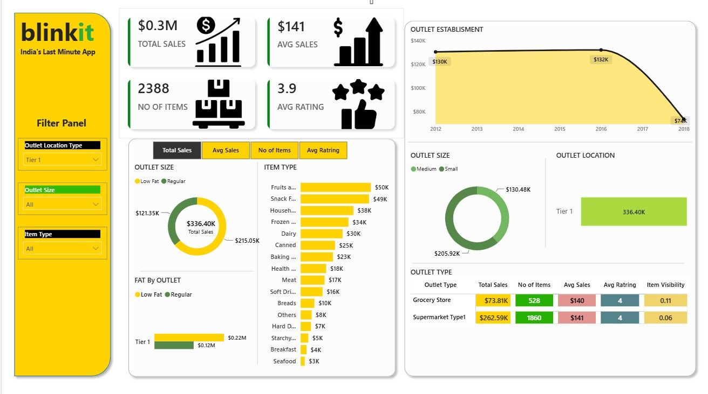
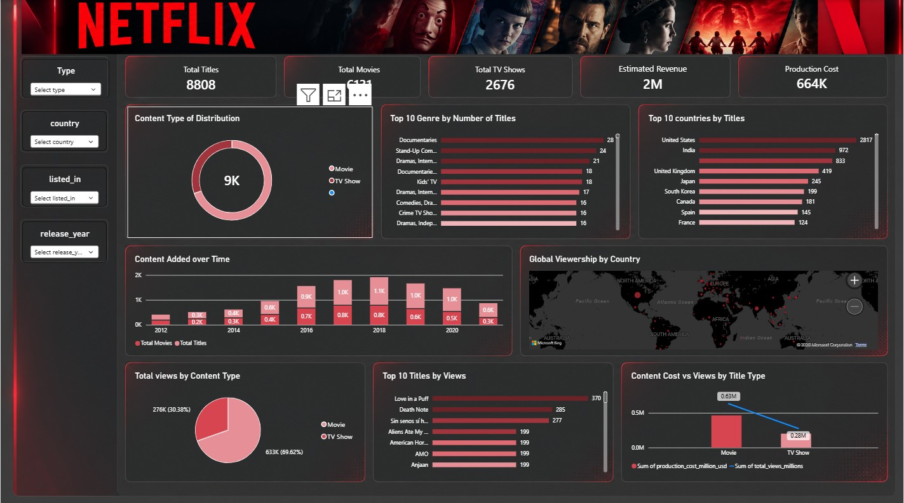

# Nikhil More — Data Analyst Portfolio

Personal portfolio website built with plain HTML, CSS and JavaScript.

Live site: https://nikhilmore2003.github.io
<div align="center">


# Nikhil More — Data Analyst Portfolio

**Turning raw data into clear dashboards and decision-ready insights.**

[](https://nikhilmore2003.github.io)
[](https://www.linkedin.com/in/nikhil-more-a43a2b259)
[](mailto:nikhilmore2003430@gmail.com)

</div>

---

## 👋 About

I'm a **Data Analyst** based in **Pune** and a B.Tech CSE graduate (NCER, 2026). I clean and shape data with **Python** and **Excel**, query it with **SQL**, and present insights through **Power BI** dashboards.

This repository holds the source code of my personal portfolio website, which showcases my projects, skills, experience, certifications and a learning log I keep updating.

🔗 **Visit:** [nikhilmore2003.github.io](https://nikhilmore2003.github.io)

---

## 🛠️ Skills


---

## 📊 Featured Projects

### Blinkit Sales Analysis — Power BI
Interactive dashboard tracking total sales, average sales, items sold and ratings, broken down by item category, outlet type, size and location.
🔗 [View Repository](https://github.com/nikhilmore2003/Blinkit-Sales-Analysis-PowerBI)



### Netflix Content Analytics — SQL
Combined three Netflix datasets in MySQL to analyse content mix, genres, countries and profitability using CTEs, joins and window functions.
🔗 [View Repository](https://github.com/nikhilmore2003/Netflix-SQL-Analytics)



### AI-Powered Psychologist Assistant — Research
Deep-learning emotion-recognition module for a prototype that analyses therapy sessions. Documented in a research paper reviewing 26 related studies.
🔗 [Read the Paper](https://drive.google.com/file/d/1OXUqMlN-LUguTNoMNbywm_3rguHzvMt8/view?usp=sharing)

### Stock Market Price Predictor — LSTM
4-layer LSTM model in Keras forecasting GOOG closing prices from ~10 years of data, with a Streamlit app comparing predicted vs. actual prices.
*Code coming soon.*

---

## 💼 Experience

**Data Analytics Intern** — Codtech IT Solutions Pvt. Ltd. *(Jan 2026 – Mar 2026)*
- End-to-end analytics workflow: data collection, cleaning, visualisation, dashboarding and reporting
- Cleaned and analysed CSV/Excel datasets with Python (Pandas, NumPy) and Excel
- Built Power BI dashboards and KPIs to summarise findings

---

## 🏅 Certifications & Job Simulations

| Organisation | Program |
|---|---|
| Quantium | Data Analytics Job Simulation |
| PwC Switzerland | Power BI Job Simulation |
| Accenture | Data Analytics & Visualization |
| Deloitte | Data Analytics Job Simulation |

---

## ✨ Website Features

- 🌗 Dark / light theme toggle (remembers your choice)
- 📱 Fully responsive on mobile, tablet and desktop
- 🗂️ Project filters by category (Power BI, SQL, Python / ML)
- 📚 Learning Log section that I update as I learn new skills
- 📄 One-click resume view and contact cards (LinkedIn, Gmail, GitHub, LeetCode)
- ⚡ Built with plain HTML, CSS and JavaScript, no frameworks

---

## 📁 Project Structure

```
├── index.html              # Page content
├── style.css               # Styling and themes
├── script.js               # Theme toggle, animations, learning log
└── assets/
    ├── profile.jpg
    ├── Nikhil_More_Resume.pdf
    └── projects/           # Project screenshots
```

---

## 🚀 Run Locally

```bash
git clone https://github.com/nikhilmore2003/nikhilmore2003.github.io.git
cd nikhilmore2003.github.io
# Open index.html in your browser
```

---

## 📬 Contact

I'm actively looking for **Data Analyst** opportunities. Let's connect!

- 📧 **Email:** [nikhilmore2003430@gmail.com](mailto:nikhilmore2003430@gmail.com)
- 💼 **LinkedIn:** [nikhil-more-a43a2b259](https://www.linkedin.com/in/nikhil-more-a43a2b259)
- 💻 **GitHub:** [nikhilmore2003](https://github.com/nikhilmore2003)
- 🧩 **LeetCode:** [nikhill_30](https://leetcode.com/u/nikhill_30/)

<div align="center">

⭐ If you like this portfolio, consider giving the repo a star!

</div>
